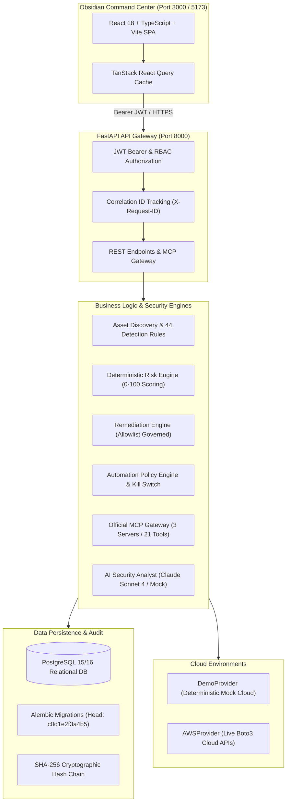

# AegisByte

**AI-Driven Cloud Security, Misconfiguration Detection, Risk Quantification, and Policy-Governed Auto-Remediation System**

[](#testing)
[](#testing)
[](#architecture)
[](#mcp-control-plane)
[](#audit-system)

---

## Overview
AegisByte is an enterprise-grade cloud security posture management (CSPM) and governed auto-remediation platform. It continuously inventories multi-service cloud infrastructure, detects complex misconfigurations through deterministic security rules, quantifies real-world risk, delivers contextual intelligence via an AI Security Analyst, and executes safe, verifiable, and tamper-evident remediations under strict human and policy governance.

---

## Problem Statement
Modern cloud infrastructure moves faster than traditional manual security reviews can govern. Security teams face:
- **Alert Fatigue & Noise**: Thousands of disconnected vulnerability alerts without clear prioritization.
- **Fear of Breaking Changes**: Engineers hesitate to remediate infrastructure misconfigurations due to unknown dependencies and fear of downtime.
- **Unchecked AI Execution Risks**: Autonomous generative AI agents making direct, unvalidated mutations to live cloud infrastructure can cause catastrophic outages or security holes.
- **Lack of Verification**: Remediations are applied without immediate, automated proof that the security gap was genuinely eliminated.

---

## Solution
CloudGuard solves this by pairing **mathematically deterministic security engines** with **advisory AI intelligence** and **policy-governed safety controls**:
1. **Deterministic Discovery & Detection**: 44 security rules evaluated without probabilistic hallucination.
2. **Deterministic Risk Quantification**: Multi-factor scoring accounting for internet exposure, data sensitivity, and blast radius.
3. **Advisory AI Analyst**: Claude Sonnet 4 synthesizes root causes and blast radiuses while remaining strictly bounded from cloud mutation APIs.
4. **Governed 6-Stage Remediation Pipeline**: Generation -> Validation -> Policy Evaluation -> Approval Gate -> Execution -> Verification.
5. **Fail-Closed Safety**: Strict remediation allowlists, separation of duties, and a global emergency kill switch.
6. **Tamper-Evident Auditability**: Every operational decision and mutation is cryptographically sealed in an append-only SHA-256 hash chain.

---

## Key Features
- **Deterministic Detection Engine**: 44 built-in rules covering AWS S3, IAM, Security Groups, Lambda, RDS, VPC, and CloudTrail.
- **Composite Risk Scoring**: Calculates resource risk (0–100) combining base severity, internet exposure, and privilege escalation factors.
- **Tri-Partite Investigation**: Clear separation of Observed Facts, AI Inferences, and Actionable Recommendations.
- **6-Stage Governed Remediation**: Complete lifecycle with dry-run diff preview and automatic verification.
- **Official Model Context Protocol (MCP)**: 3 registered servers exposing 21 tools categorized into READ, WRITE, and DESTRUCTIVE classes.
- **Policy-Governed Automation**: 8 pre-configured automation policies with safety tiers and automated progression.
- **Emergency Kill Switch**: Immediate cluster-wide halt for all automated and interactive mutations.
- **Obsidian Command Center UI**: Modern, dark-mode React + TypeScript interface built for security engineers.
- **Zero-Trust Auth & RBAC**: Argon2id password hashing, rotating JWT access/refresh tokens, and server-side RBAC.

---

## Architecture



---

## Technology Stack

| Layer | Technologies |
| :--- | :--- |
| **Frontend** | React 18, TypeScript, Vite 8, Tailwind CSS, Lucide React, TanStack Query |
| **Backend API** | Python 3.11+, FastAPI, Pydantic v2, Structlog, Uvicorn |
| **Database & ORM** | PostgreSQL 15/16, SQLAlchemy 2.0, Alembic |
| **Security & Auth** | Argon2id (`argon2-cffi`), python-jose (JWT), RBAC |
| **AI & LLM** | Anthropic Python SDK (Claude Sonnet 4), deterministic fallback |
| **Tool Protocol** | Official Model Context Protocol (MCP) SDK v2.2 |
| **Cloud Integration**| Boto3, Botocore |
| **Testing** | Pytest, Pytest-Asyncio, Vitest, React Testing Library, Oxlint |
| **Containerization**| Docker, Docker Compose, Nginx Alpine |

---

## Cloud Discovery
CloudGuard scans and inventories infrastructure across core AWS services:
- **Amazon S3**: Buckets, public access blocks, bucket policies, encryption, and ACLs.
- **AWS IAM**: Users, roles, policies, inline statements, MFA configuration, and credential age.
- **Amazon EC2 & VPC**: Security groups, ingress/egress rules, default VPCs, flow logs, internet gateways.
- **AWS Lambda**: Function configurations, runtime versions, dead-letter queues, VPC integration.
- **Amazon RDS**: Database instances, public accessibility, storage encryption, automated backups.
- **AWS CloudTrail**: Multi-region trail status, log file validation, and CloudWatch integration.

---

## Detection Engine
The detection engine runs **44 deterministic security rules** that evaluate resource JSON snapshots against security specifications without external AI hallucinations. Rules include:
- `S3-001`: Public access block disabled.
- `S3-002`: Server-side encryption disabled.
- `SG-001`: Unrestricted SSH access from 0.0.0.0/0.
- `IAM-001`: Root account API access key present.
- `IAM-002`: IAM policy grants administrator privileges (`*/*`).
- `RDS-001`: RDS database instance is publicly accessible.

---

## Risk Engine
Risk scores (0 to 100) are computed through a multi-factor mathematical formula:
$$\text{Risk Score} = \min\left(100, \text{Base Severity Weight} \times (1.0 + \sum \text{Risk Multipliers})\right)$$
- **Base Severity Weights**: Critical (40), High (25), Medium (15), Low (5).
- **Risk Multipliers**:
  - Internet Exposure: $+40\%$
  - Privilege Escalation: $+30\%$
  - Data Exposure: $+30\%$
  - Production Environment: $+20\%$

---

## AI Security Analyst
The AI Security Analyst is powered by Anthropic's Claude Sonnet 4 (or an offline deterministic demo provider). It produces a **Tri-Partite Investigation Report**:
1. **Observed Facts**: Immutable, factual configuration values directly observed from cloud APIs.
2. **AI Inferences**: Attack path analysis, blast radius estimation, and potential impact.
3. **Recommendations**: Concrete remediation strategies and compensation controls.

---

## AI Agent Orchestration
AI agents operate within strict, non-bypassable guardrails:
- **Advisory Only**: AI cannot directly execute cloud mutations or change infrastructure state.
- **Context Ceiling**: Inputs are capped at 32,768 bytes with automatic secret redaction.
- **Bounded Tool Calls**: AI agents are restricted to a maximum of 5 tool calls per run.
- **Untrusted Input Sanitization**: Cloud tags and metadata are sanitized before prompt injection.

---

## MCP Control Plane
CloudGuard implements the official **Model Context Protocol (MCP)** specification:
- **3 Registered Servers**: `cloudguard-discovery-mcp`, `cloudguard-security-mcp`, `cloudguard-remediation-mcp`.
- **21 Governed Tools**: Resource queries, finding lookups, posture evaluation, and plan generation.
- **Semantic Classification**: Tools are strictly segregated into `READ`, `WRITE`, and `DESTRUCTIVE` operations.
- **Parameter Validation**: Input schemas are verified against strict JSON Schema definitions before tool dispatch.

---

## Safe Remediation
Remediation follows a strict **safety allowlist**:
- Approved strategies: `S3-001` (Enable Public Access Block) and `SG-001` (Revoke Open SSH).
- Unapproved strategies are blocked at the engine boundary (`HTTP 400`).
- **Separation of Duties**: Plan creators cannot approve their own remediation plans.
- **Diff Previews**: Pre- and post-remediation configuration diffs are presented before approval.

---

## Policy-Governed Automation
CloudGuard provides an automation engine with **8 pre-configured policies**:
- **Safety Tiers**:
  - *Tier 1 (Safe Auto)*: Automatically validated and approved for low-risk, non-destructive findings.
  - *Tier 2 (Governed Approval)*: Automated plan creation with mandatory human approval.
  - *Tier 3 (Manual Only)*: High-impact configurations requiring end-to-end human execution.
- **Emergency Kill Switch**: A global kill switch that immediately halts all automated progressions and executions cluster-wide.

---

## Verification Pipeline
After any remediation executes, CloudGuard triggers an immediate, targeted verification scan:
1. Re-queries the target resource from cloud APIs.
2. Re-evaluates the associated detection rule.
3. Confirms whether the misconfiguration was resolved.
4. Marks the remediation plan as `VERIFIED` and the finding as `RESOLVED`, or flags `VERIFICATION_FAILED` and reopens the finding.

---

## Authentication & RBAC
- **Argon2id Hashing**: Industry-standard password hashing using `argon2-cffi`.
- **Rotating JWT Tokens**: 30-minute access tokens and 7-day refresh tokens with reuse detection and family revocation.
- **4 Granular Roles**:
  - `ADMIN`: Full platform configuration, user management, and kill switch access.
  - `SECURITY_ANALYST`: Scan creation, finding triage, AI investigations, and plan generation.
  - `OPERATOR`: Remediation plan validation, execution, and MCP tool invocation.
  - `VIEWER`: Read-only access to posture, findings, and reports.

---

## Audit System
All remediation actions, policy evaluations, and MCP tool invocations generate cryptographically sealed audit events:
- **Algorithm**: Tamper-evident, append-only SHA-256 hash-chained ledger.
- **Hash Formula**: $\text{Hash}_n = \text{SHA256}(\text{Sequence} \,\|\, \text{Timestamp} \,\|\, \text{User ID} \,\|\, \text{Payload} \,\|\, \text{Hash}_{n-1})$
- Any modification to historical audit records invalidates subsequent hashes in the chain.

---

## Demo Mode
CloudGuard runs fully offline in **Demo Mode** (`CLOUDGUARD_MODE=demo`):
- No AWS credentials or Anthropic API keys required.
- Uses `DemoProvider` to generate deterministic resources and findings.
- Fully reproducible demo scenarios: `default`, `critical`, and `healthy`.

---

## AWS Mode
In **AWS Mode** (`CLOUDGUARD_MODE=aws`):
- Connects to real AWS APIs via `boto3`.
- Requires read-only AWS IAM credentials or an attached instance IAM role.
- Scans user-specified AWS regions (`AWS_SCAN_REGIONS`).

---

## Installation

### Prerequisites
- Python 3.11+
- Node.js 20+
- PostgreSQL 15/16

### Setup
```bash
# 1. Clone repository
git clone https://github.com/organization/cloudguard.git
cd cloudguard

# 2. Configure environment
cp .env.example .env

# 3. Backend Setup
cd backend
python -m venv venv
source venv/bin/activate  # Windows: .\venv\Scripts\activate
pip install -r requirements.txt
alembic upgrade head
python -m uvicorn main:app --host 0.0.0.0 --port 8000

# 4. Frontend Setup (in separate terminal)
cd frontend
npm install
npm run dev
```

---

## Environment Configuration
See [.env.example](.env.example) for a fully documented template. Key configuration variables:
- `CLOUDGUARD_MODE`: `demo` or `aws`.
- `DATABASE_URL`: PostgreSQL connection string.
- `JWT_SECRET_KEY`: Cryptographically secure 32-character secret.
- `AI_PROVIDER`: `demo` or `anthropic`.
- `ANTHROPIC_API_KEY`: Anthropic API key (optional).

---

## Docker Deployment
CloudGuard includes production-ready Docker configurations:
```bash
# Launch entire stack (PostgreSQL, Backend, Frontend)
docker compose up -d

# View logs
docker compose logs -f
```
Services exposed:
- **Frontend Command Center (Canonical HTTPS)**: `https://localhost` (Port 443; HTTP on port 80 redirects to HTTPS)
- **Backend API (Reverse Proxied)**: `https://localhost/api`
- **Swagger Documentation**: `https://localhost/docs`

---

## API Overview
The REST API is documented interactively via OpenAPI:
- Swagger UI: `https://localhost/docs` (or `http://127.0.0.1:8000/docs` in dev)
- ReDoc: `https://localhost/redoc` (or `http://127.0.0.1:8000/redoc` in dev)
- Detailed endpoint mapping: [docs/api.md](docs/api.md)

---

## Testing
CloudGuard maintains comprehensive test coverage:

```bash
# Backend test suite (778 tests)
cd backend
pytest -v

# Frontend test suite (63 tests)
cd frontend
npm test -- --run

# Frontend type check & production build
npm run build

# Frontend linting
npm run lint
```

---

## Security Model
For in-depth details on the security architecture, RBAC permissions matrix, and defense-in-depth protections, see [docs/security.md](docs/security.md).

---

## Project Structure
```text
CloudGuard/
├── backend/
│   ├── alembic/              # Database migration revisions
│   ├── api/                  # FastAPI routers, schemas, error handlers
│   ├── auth/                 # JWT, Argon2id, RBAC, session management
│   ├── config/               # Pydantic application settings
│   ├── core/
│   │   ├── ai/               # AI analyst orchestrator and rate limiter
│   │   ├── automation/       # Policy evaluation engine & kill switch
│   │   ├── mcp/              # MCP gateway, registry, and server definitions
│   │   ├── providers/        # AWS and Demo cloud providers
│   │   ├── remediation/      # 6-stage lifecycle and strategy registry
│   │   ├── risk/             # Deterministic risk engine
│   │   └── security/         # 44 detection rules and relationship graph
│   ├── services/             # Orchestration and business service layer
│   ├── tests/                # 778 backend unit and integration tests
│   ├── Dockerfile            # Python backend container specification
│   └── requirements.txt      # Python dependencies
├── frontend/
│   ├── src/
│   │   ├── api/              # Strongly-typed API client services
│   │   ├── components/       # Obsidian Command Center design system
│   │   ├── pages/            # 12 flagship operational views
│   │   ├── test/             # 63 Vitest & RTL test cases
│   │   └── types/            # TypeScript domain schemas
│   ├── Dockerfile            # Multi-stage Nginx production container
│   ├── nginx.conf            # SPA routing & security headers configuration
│   └── package.json          # Frontend dependencies & scripts
├── docs/                     # Comprehensive architecture and security documentation
│   ├── architecture.md       # Overall architecture & Mermaid diagram
│   ├── security.md           # Authentication, RBAC, and threat model
│   ├── deployment.md         # Docker Compose and bare-metal guide
│   ├── api.md                # Complete REST API reference
│   ├── ai-agents.md          # AI security analyst and guardrails
│   ├── mcp.md                # Model Context Protocol control plane
│   ├── remediation.md        # 6-stage remediation lifecycle & allowlist
│   └── testing.md            # Test suites and audit verification
├── .env.example              # Master configuration template (placeholders only)
├── .gitignore                # Production repository ignore specification
├── docker-compose.yml        # Multi-container production deployment
└── README.md                 # Master project documentation
```

---

## Limitations
- **Cloud Provider Scope**: Live cloud discovery and remediation currently support Amazon Web Services (AWS). Multi-cloud support (Azure/GCP) is not implemented.
- **Remediation Allowlist**: Safe auto-remediation is currently restricted to S3 Public Access Block (`S3-001`) and Security Group Open SSH (`SG-001`). Other finding types require manual remediation.
- **Advisory AI**: AI outputs are strictly advisory recommendations and require human review or policy governance before application.

---

## Future Extensions
- Extension of remediation strategies to IAM credential rotation and RDS encryption.
- Multi-cloud provider adapters for Google Cloud Platform (GCP) and Microsoft Azure.
- Automated compliance reporting frameworks (SOC 2, HIPAA, NIST CSF).
- Real-time event-driven discovery via AWS EventBridge and CloudTrail streaming.
