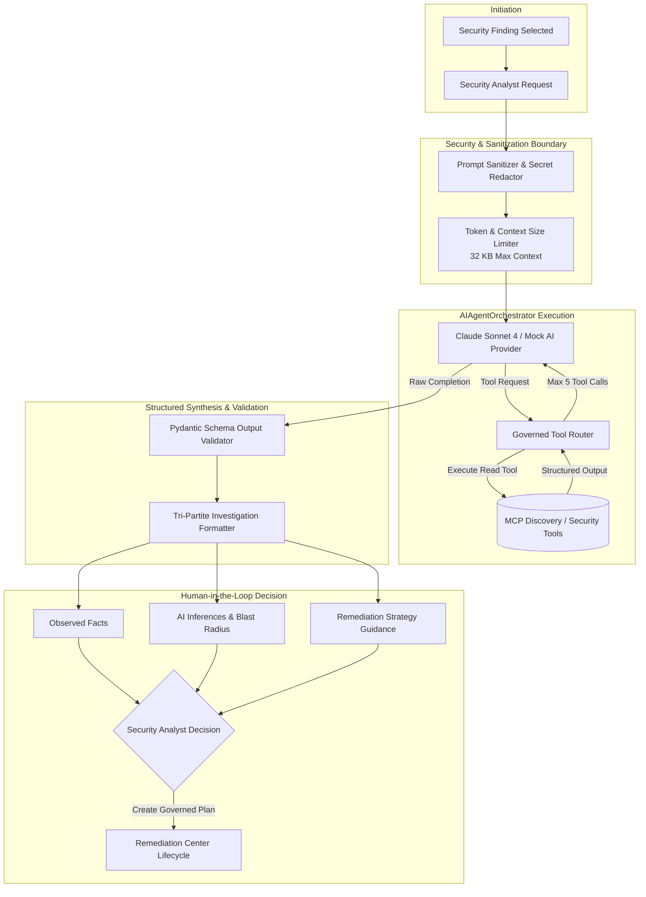

# CloudGuard — AI Security Analyst & Agent Orchestration

## 1. Overview & Operational Boundaries
CloudGuard features an AI Security Analyst designed to interpret complex security misconfigurations, synthesize blast radiuses, and recommend remediation steps. 

> [!IMPORTANT]
> **Strict Advisory Boundary**: AI is strictly advisory. AI agents **cannot directly invoke AWS APIs**, **cannot bypass the remediation allowlist**, and **cannot self-approve remediation actions**. Every remediation plan requires human approval or an explicit, policy-governed automation decision.

---

## 2. AI Agent Orchestration Flow

---

## 3. Defense Against Prompt Injection
1. **Untrusted Data Isolation**: All cloud resource tags, bucket names, and IAM policy documents are treated as untrusted strings. They are encapsulated within strictly formatted markdown/JSON tags in the prompt.
2. **Context Window Enforcement**: A hard ceiling of 32,768 bytes (`MAX_AI_CONTEXT_BYTES`) prevents buffer flooding and context manipulation attacks.
3. **Structured Pydantic Parsing**: AI output is forced into typed models (`AIAnalysisResponse`). Free-form arbitrary shell or script output is rejected.
4. **Tool-Call Capping**: Orchestrator terminates agent execution after at most 5 tool calls (`MAX_AI_TOOL_CALLS = 5`) or 15 seconds runtime limit.
