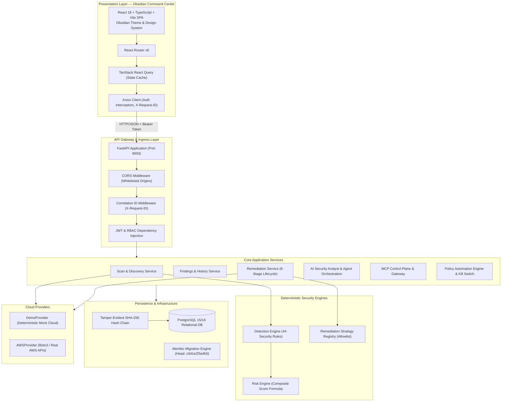

# CloudGuard — Architecture Documentation

## 1. Executive Summary
CloudGuard is an AI-powered cloud misconfiguration detection, risk quantification, and policy-governed automated remediation system. It provides real-time visibility across multi-service AWS architectures, quantifies infrastructure risk through deterministic mathematical scoring, and delivers governed, tamper-evident remediation actions via human-in-the-loop and automated workflows.

---

## 2. System Architecture Overview

---

## 3. Core Architectural Principles

1. **Deterministic Core with Advisory AI**: Security rules, risk calculations, policy evaluations, and remediation strategies execute with mathematical determinism. Generative AI is strictly advisory and cannot execute cloud mutations directly.
2. **Strict Remediation Allowlist**: Remediation is limited to explicitly validated and safe strategies (`S3-001`, `SG-001`). Unrecognized or generic remediation requests are blocked at the engine boundary.
3. **Defense-in-Depth Authorization**: Every backend endpoint enforces server-side RBAC using JWT bearer tokens and Argon2id password verification. Client-side role visibility is purely UX ergonomics.
4. **Append-Only Tamper-Evident Auditability**: All security actions, policy progressions, and MCP invocations generate cryptographic audit events chained via SHA-256 hashes (`previous_hash` + event contents -> `event_hash`).
5. **Separation of Duties**: The creator of a remediation plan cannot approve their own plan in environments requiring separation of duties.
6. **Fail-Closed Emergency Protection**: The global automation kill switch immediately halts all automated remediation progressions and policy executions.
