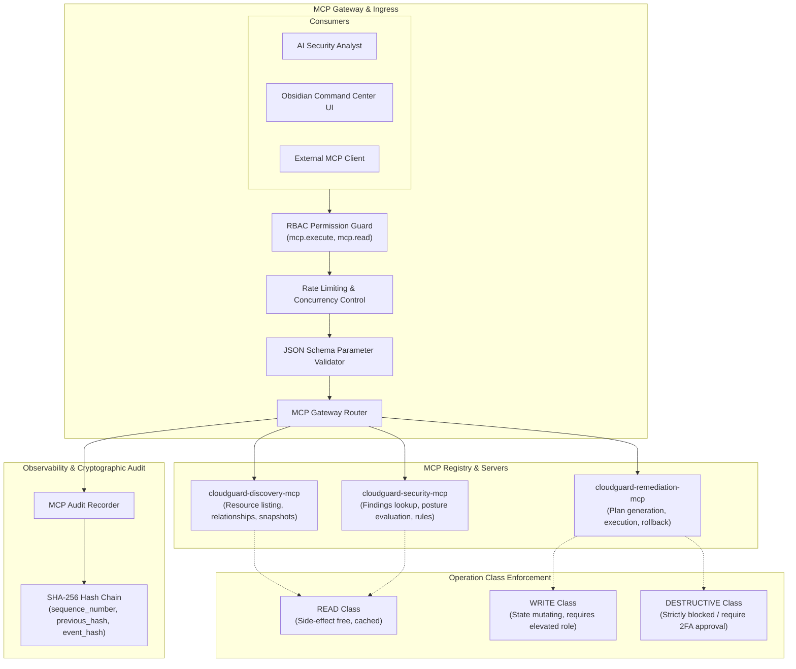

# CloudGuard — Model Context Protocol (MCP) Control Plane

## 1. Overview
CloudGuard integrates an enterprise-grade Model Context Protocol (MCP) Control Plane using the official Model Context Protocol SDK. It standardizes how AI agents, operators, and external tools interact with security discovery, analysis, and remediation primitives.

---

## 2. MCP Control Plane Architecture

---

## 3. Registered Servers & Tool Inventory

CloudGuard registers 3 MCP servers exposing 21 dedicated security tools:

### 3.1 `cloudguard-discovery-mcp` (Port / In-process)
- `list_cloud_accounts`: Discover configured accounts. (READ)
- `list_resources`: Enumerate discovered cloud assets with filters. (READ)
- `get_resource`: Fetch resource configuration payload. (READ)
- `get_resource_relationships`: Traverse infrastructure dependency graph. (READ)
- `get_resource_snapshot`: Retrieve historical configuration state. (READ)

### 3.2 `cloudguard-security-mcp`
- `list_findings`: Query security misconfigurations. (READ)
- `get_finding_detail`: Retrieve complete finding evidence. (READ)
- `get_security_posture`: Query risk scoring breakdown. (READ)
- `list_security_rules`: Inspect active detection catalog. (READ)
- `evaluate_rule`: Deterministically evaluate resource against rule. (READ)

### 3.3 `cloudguard-remediation-mcp`
- `get_remediation_strategy`: Check if rule has approved strategy. (READ)
- `create_remediation_plan`: Generate deterministic plan. (WRITE)
- `validate_remediation_plan`: Validate preconditions. (WRITE)
- `execute_remediation`: Execute approved strategy. (WRITE)
- `verify_remediation`: Run verification scan. (READ)
- `rollback_remediation`: Revert executed remediation. (DESTRUCTIVE)

---

## 4. Security & Governance Controls
1. **Schema Validation**: Every tool input is validated against strict JSON Schema schemas generated from Pydantic models before execution.
2. **Output Truncation**: Tool outputs exceeding 8,192 bytes are safely truncated to prevent prompt injection and memory exhaustion.
3. **Audit Correlation**: Every tool execution generates an immutable audit record tied to `request_id`, `correlation_id`, `user_id`, execution duration, and cryptographic hash chain.
