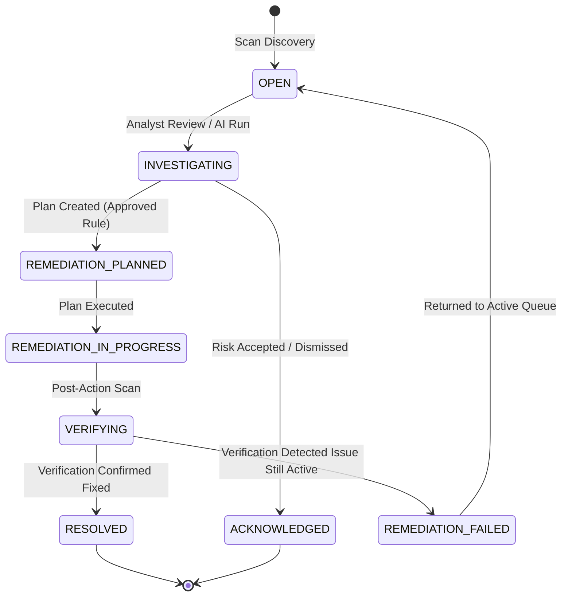
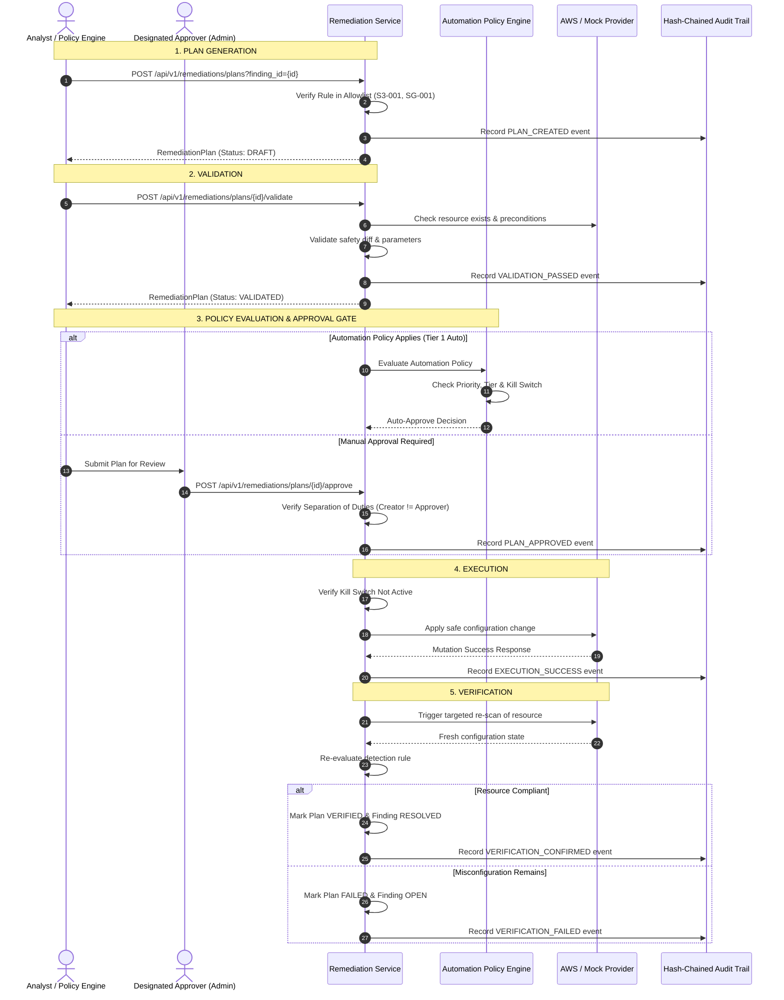

# CloudGuard — Remediation Lifecycle & Safe Automation

## 1. Overview
Remediation in CloudGuard is governed by a strict safety pipeline designed to eliminate unauthorized, arbitrary, or destructive changes to cloud infrastructure.

> [!CAUTION]
> **Remediation Allowlist**: Remediation is restricted strictly to approved and deterministic strategies:
> - `S3-001` (and `s3-public-access-block-disabled`): Enforce S3 Public Access Block.
> - `SG-001` (and `ec2-sg-open-ssh`): Revoke unrestricted SSH ingress (0.0.0.0/0).
> 
> All other findings cannot be remediated directly. Attempting to execute unapproved remediation returns `HTTP 400: No supported remediation strategy`.

---

## 2. Finding Lifecycle

---

## 3. 6-Stage Governed Remediation Pipeline

---

## 4. Key Remediation Safeguards
1. **Separation of Duties**: In environments requiring multi-party authorization, the user who created the remediation plan cannot approve it. Self-approval attempts are blocked with `HTTP 400 / 403`.
2. **Emergency Kill Switch**: The global kill switch halts all execution immediately. When active, any invocation of `/execute` or automated policy evaluation fails with `KillSwitchActiveError`.
3. **Rollback Capabilities**: Every executed strategy captures a snapshot of the pre-remediation configuration to facilitate rollback via the MCP Control Plane or API.
