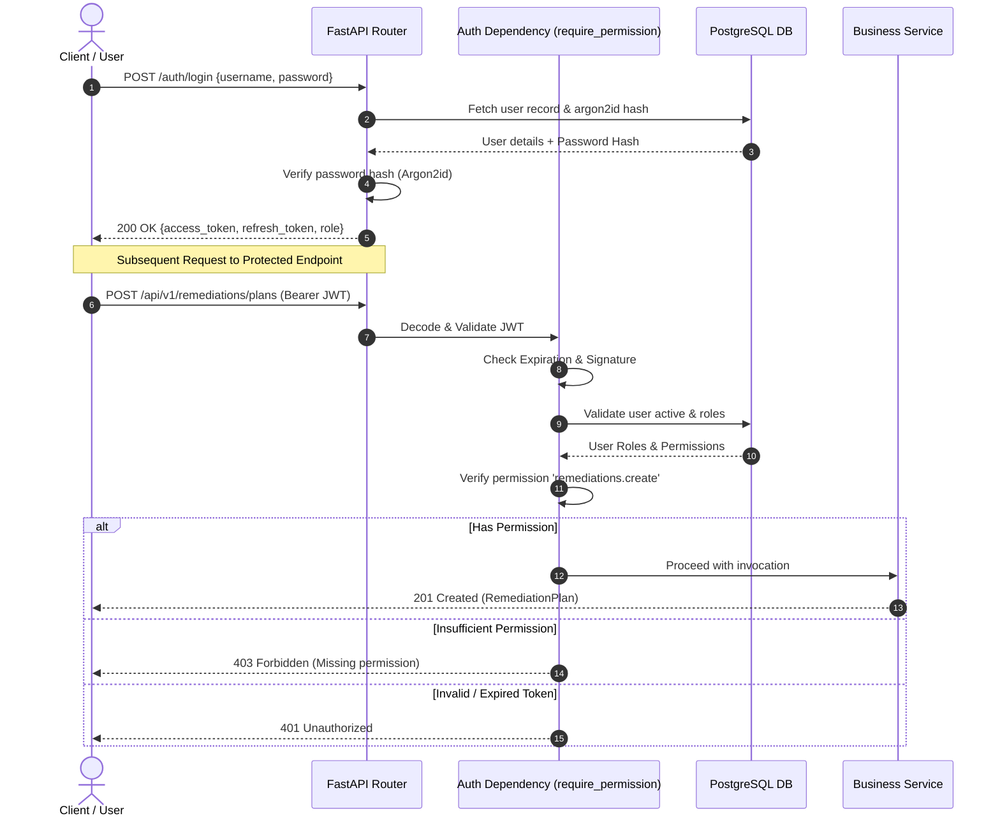

# CloudGuard — Security & Access Control Model

## 1. Authentication Architecture
CloudGuard implements a zero-trust authentication architecture based on OAuth2 Password Bearer flow, JSON Web Tokens (JWT), and Argon2id password hashing (NIST SP 800-63B compliant).

### 1.1 Password Hashing
- **Algorithm**: Argon2id via `argon2-cffi` and `passlib`.
- **Parameters**: Memory cost: 65,536 KiB, Time cost: 3 iterations, Parallelism: 4 threads.
- Passwords are never stored in plaintext and cannot be recovered via side-channel attacks.

### 1.2 Token Lifecycle
- **Access Tokens**: Short-lived (30 minutes default), signed via HMAC-SHA256 with `JWT_SECRET_KEY`. Contain user ID, username, and assigned roles.
- **Refresh Tokens**: Long-lived (7 days default), cryptographically random tokens stored in PostgreSQL with family tracking.
- **Refresh Token Rotation & Revocation**: Upon use, a refresh token is invalidated and replaced with a new pair. If an already-used refresh token is presented (token reuse attempt), the entire token family is immediately revoked to prevent token replay attacks.

---

## 2. Role-Based Access Control (RBAC)

### 2.1 Role Hierarchy & Permissions Matrix

| Permission | ADMIN | SECURITY_ANALYST | OPERATOR | VIEWER |
| :--- | :---: | :---: | :---: | :---: |
| `scans.read` | ✅ | ✅ | ✅ | ✅ |
| `findings.read` | ✅ | ✅ | ✅ | ✅ |
| `posture.read` | ✅ | ✅ | ✅ | ✅ |
| `rules.read` | ✅ | ✅ | ✅ | ✅ |
| `investigation.read` | ✅ | ✅ | ✅ | ✅ |
| `scans.create` | ✅ | ✅ | ✅ | ❌ |
| `remediations.create` | ✅ | ✅ | ✅ | ❌ |
| `remediations.validate` | ✅ | ✅ | ✅ | ❌ |
| `remediations.execute` | ✅ | ❌ | ✅ | ❌ |
| `remediations.approve` | ✅ | ❌ | ❌ | ❌ |
| `ai.analyze` | ✅ | ✅ | ❌ | ❌ |
| `mcp.read` | ✅ | ✅ | ✅ | ✅ |
| `mcp.execute` | ✅ | ✅ | ✅ | ❌ |
| `mcp.manage` | ✅ | ❌ | ❌ | ❌ |
| `automation.read` | ✅ | ✅ | ✅ | ✅ |
| `automation.manage` | ✅ | ❌ | ❌ | ❌ |
| `automation.killswitch`| ✅ | ❌ | ❌ | ❌ |
| `users.manage` | ✅ | ❌ | ❌ | ❌ |

---

## 3. Defense-in-Depth Protections

1. **Server-Side Enforcement**: All authorization decisions occur within FastAPI dependency functions (`require_permission`, `require_role`). Client-side guards are strictly visual.
2. **IDOR & Multi-Tenant Boundaries**: Resources verify ownership and tenant scope before mutations or retrieval.
3. **Prompt Injection & AI Sanitization**: Cloud resource metadata is treated as untrusted external input and sanitized before inclusion in AI context windows. AI output is parsed into strict Pydantic schemas.
4. **Emergency Kill Switch**: Fails closed. Immediate termination of all automated remediation and agent loops across the cluster.
