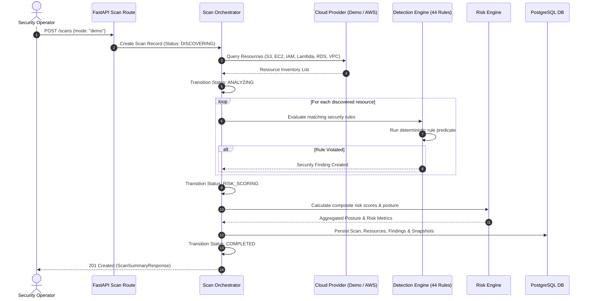
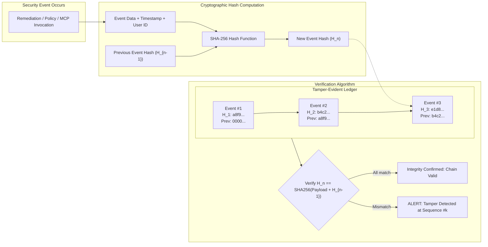

# CloudGuard — Testing, Discovery & Audit Verification

## 1. Overview
CloudGuard maintains rigorous quality and security standards across the full development lifecycle. All core detection, risk quantification, authentication, and remediation behaviors are verified via automated test suites.

- **Backend Baseline**: 778 / 778 tests passing (`pytest` with PostgreSQL 15/16).
- **Frontend Baseline**: 63 / 63 tests passing across 10 test suites (`vitest` with React Testing Library).

---

## 2. Cloud Discovery Flow



---

## 3. Cryptographic Audit Trail Flow



---

## 4. Running the Master Test Suites

### 4.1 Backend Test Execution
Run the full backend test suite with PostgreSQL:
```bash
cd backend
pytest -v
```
To run with coverage reporting:
```bash
pytest --cov=. --cov-report=term-missing
```

### 4.2 Frontend Test Execution
Run all 63 unit and integration tests:
```bash
cd frontend
npm test -- --run
```
To run type checking and linting:
```bash
npm run build   # Runs tsc -b && vite build
npm run lint    # Runs oxlint
```

### 4.3 End-to-End API Integration Verification
Execute the master E2E verification script:
```bash
python scratch/security_audit_verify.py
```
